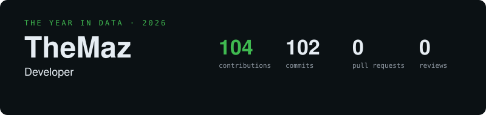
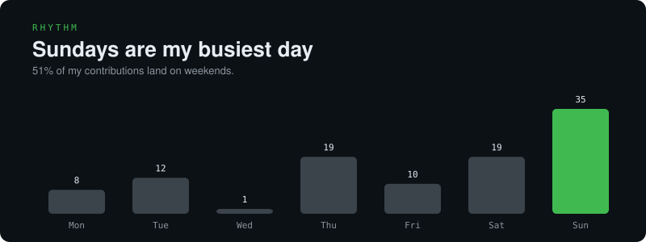

  

  

## 🧬 Streak & activité

  

  

## 📅 Rythme

  

## 💻 De quoi mon code est fait

<!-- La taille de chaque logo est proportionnelle à son pourcentage (≈ 3 px par %) -->
<table align="center">
  <tr align="center" valign="bottom">
    <td>
       
      <b>Shell</b> 22%
    </td>
    <td>
       
      <b>CSS</b> 28%
    </td>
    <td>
       
      <b>PHP</b> 21%
    </td>
  </tr>
</table>
